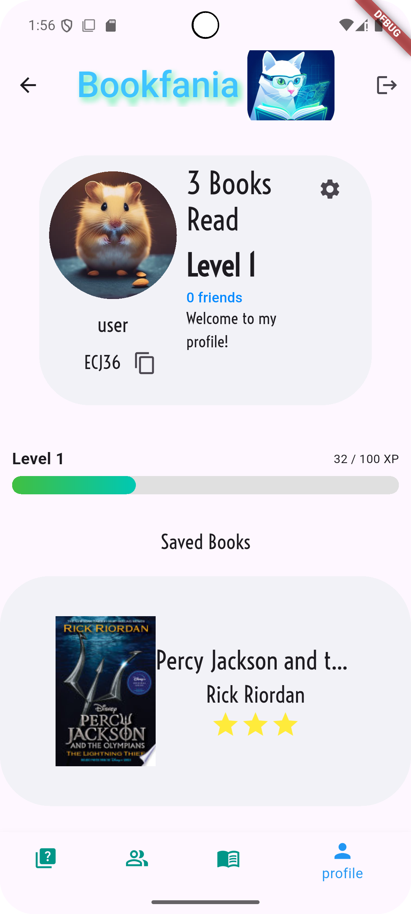
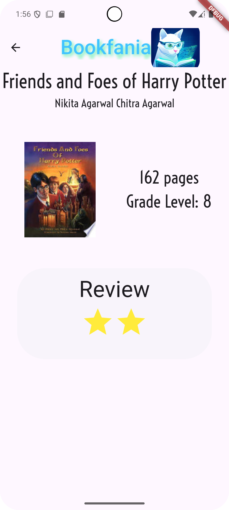

> Historical classroom prototype write-up. For current features and architecture, see [README](README.md).

# Readigo: An AI-Powered Reading Companion and Educational Platform for Enhancing Literacy and Comprehension Through Personalized Quizzes and Social Reading Engagement

## Background of the Invention (150 words)

My invention is built using the Flutter framework, a cross-platform mobile development framework that enables deployment on both iOS and Android devices. This invention is intended for multiple groups of people, including students from elementary through high school, educators seeking to assess reading comprehension, parents monitoring their children's reading progress, and avid readers of all ages who wish to deepen their understanding of literature. These intended audiences often face significant challenges in maintaining reading engagement, verifying comprehension of material, and finding age-appropriate books that match their reading level. In educational settings, teachers struggle to create customized assessments for diverse reading materials, while students lack immediate feedback on their understanding. In home environments, parents have difficulty tracking their children's reading habits and comprehension development. These problems affect local communities by contributing to declining literacy rates, reduced academic performance, and decreased engagement with literature. My invention improves their quality of life by providing an intelligent, automated system that generates personalized comprehension quizzes, tracks reading progress, facilitates book discovery, and creates a social reading community that motivates continued engagement with literature.

## Summary of the Invention (150 words)

The significance of my invention is directly tied to the widespread problem of declining reading comprehension and lack of personalized educational assessment tools that my intended audience faces daily. My invention addresses this by leveraging artificial intelligence to automatically generate customized reading comprehension quizzes based on any book, with adjustable difficulty levels and question counts tailored to individual learners. While other products on the market such as Goodreads provide book tracking and reviews, and platforms like Kahoot offer generic quizzes, none combine AI-powered, book-specific quiz generation with social reading features and personal library management in a single, integrated mobile application. My invention improves upon these existing products by eliminating the need for manual quiz creation, providing instant comprehension assessment, and creating a gamified learning environment with user levels, followers, and reading statistics. The main features include intelligent book search using Google Books API integration, AI-generated multiple-choice quizzes with 12 difficulty levels, a personal digital library with review and rating capabilities, social networking features with friend codes and messaging, and comprehensive reading progress tracking with user leveling systems.

## Detailed Description of the Invention (200 words)

Upon launching my invention, users are greeted with the Landing Page, which presents the Readigo logo and branding along with options to either log in to an existing account or create a new account. The login screen utilizes Firebase Authentication and supports Google Sign-In functionality for secure, convenient access. After successful authentication, users arrive at the main Homepage, which features a bottom navigation bar with four primary sections: Quiz, Friends, Books, and Profile.

In the Quiz section, users first select a book from their library or search for a new book. They then customize their quiz experience using two interactive sliders: one adjusts the question difficulty from Level 1 to Level 12, and another sets the number of questions from 5 to 25. Upon tapping the "Start Quiz" button, my invention sends a request to OpenAI's GPT-4 API with specific parameters about the selected book, difficulty level, and question count. The AI generates unique multiple-choice questions with four answer options for each question. Users interact with these questions through a swipeable page view interface, selecting their answers by tapping on choice buttons.

The Books section provides a search interface where users enter book titles or authors. My invention queries the Google Books API and displays results as scrollable book tiles, each showing the book's cover image, title, author, and page count. Users can tap on any book to view a detailed preview screen with additional information and a link to purchase the book. When users tap "Add to Library," they are directed to a Book Review Page where they can write optional text reviews and assign star ratings from 1 to 5 stars by tapping interactive star icons. This information is then stored in their Cloud Firestore database associated with their user account.

The Friends section displays a searchable list of connected users, each shown as a "friend tile" containing their profile picture, username, unique friend code (such as #00001), and their most recent message. Users can search for friends using the search bar at the top of the screen. The Profile section showcases the user's circular profile picture, username, and unique friend code with a copy button for easy sharing. It displays reading statistics including total books read (e.g., "20 Books Read"), current achievement level (e.g., "Level 3"), follower count, and following count. Below this information panel, the profile displays the user's personal library as a scrollable list of book tiles, each showing the book cover, title, author, and the user's personal rating and review if provided.

## Screenshots

### Screenshot 1: Quiz Generation Screen

*The quiz generation interface showing book selection, difficulty slider (Level 1-12), and question count slider (5-25 questions)*

### Screenshot 2: User Profile and Library

*The user profile displaying reading statistics, level progression, social connections, and personal library with reviews and ratings*

## Abstract of the Disclosure (100 words)

The problem that my targeted audience often faces is the lack of personalized reading comprehension assessment tools and insufficient motivation to maintain consistent reading habits, particularly among students and young readers. My solution is an AI-powered mobile application that combines intelligent book discovery, automated quiz generation, and social reading features into a unified platform. My invention searches books using Google Books API integration, generates customized comprehension quizzes using OpenAI's GPT-4 technology with adjustable difficulty levels and question counts, manages personal digital libraries with review and rating capabilities, tracks reading progress through user levels and statistics, and facilitates social engagement through friend connections and reading communities. This invention solves the issue by providing immediate, personalized feedback on reading comprehension, automating the traditionally labor-intensive quiz creation process, and creating an engaging, gamified environment that motivates continued reading and learning.
